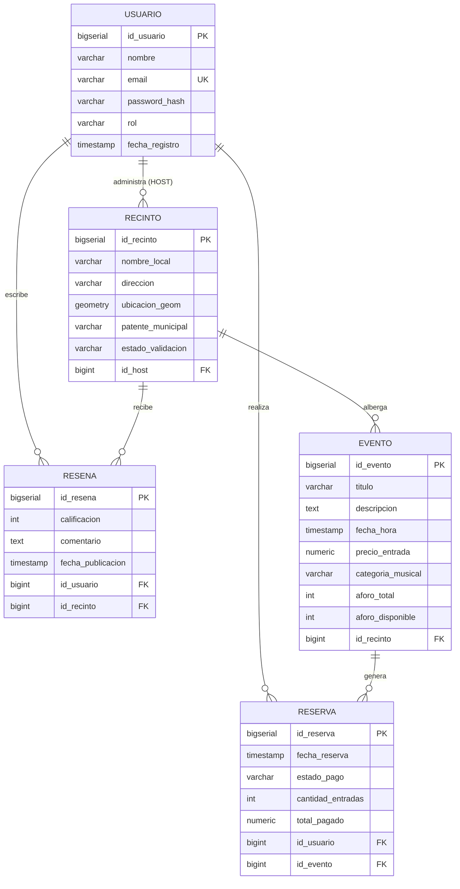
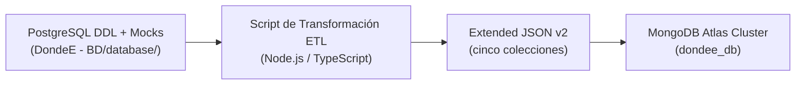
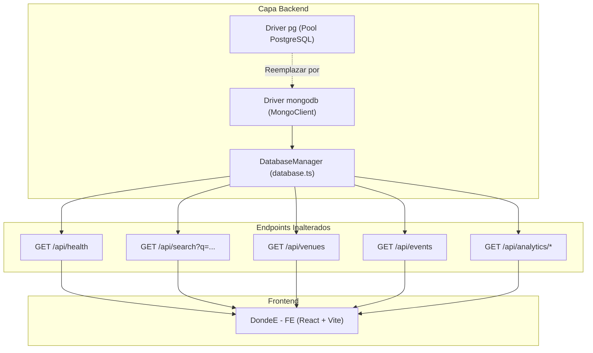

# Plan Maestro y Análisis Arquitectural: Migración de PostgreSQL/PostGIS a MongoDB NoSQL (Entrega 2)

**Proyecto:** DondeE — Plataforma Geo-Social de Vida Nocturna  
**Asignatura:** ICI 324 - Bases de Datos y Programación Web (2026)  
**Institución:** Universidad de Valparaíso / Escuela de Ingeniería Informática  
**Grupo de Desarrollo:** Grupo 2 (Martín Araya, Jorge Bahamondes, Bruno Díaz)  
**Rol Profesional:** Senior NoSQL Database Architect & Full-Stack Systems Engineer  
**Fecha:** Octubre 2026  

---

## 1. Resumen Ejecutivo y Alcance

Este documento constituye el **análisis técnico y formal de arquitectura** para ejecutar la transición de la base de datos relacional (`DondeE - BD/database/init.sql`) utilizada en la Entrega 1 hacia un motor NoSQL orientado a documentos (**MongoDB Atlas Cluster**), cumpliendo los estándares de la **Entrega 2**.

### Objetivos Clave:
1. **Rediseñar el modelo relacional a un modelo documental**, aprovechando las capacidades nativas de MongoDB (embebido de subdocumentos, desnormalización estratégica y GeoJSON).
2. **Definir el pipeline de conversión a formato `.json`**, preservando la integridad de los 42 locales validados, los 126 eventos nocturnos de Valparaíso y Viña del Mar, los usuarios y el histórico transaccional.
3. **Establecer la estrategia de geolocalización NoSQL**, reemplazando funciones PostGIS (`ST_SetSRID`, `ST_MakePoint`, `ST_DWithin`) por índices espaciales `2dsphere` y operadores geoespaciales (`$near`, `$geoNear`, `$geoWithin`).
4. **Garantizar la compatibilidad total con el Frontend**, manteniendo inalterados los contratos REST (`/api/search`, `/api/venues`, `/api/events`, etc.) para que la aplicación web funcione de manera transparente y sin fricción.

---

## 2. Diagnóstico del Estado Actual (Modelo Relacional - Entrega 1)

El sistema de la Entrega 1 se compone de **5 tablas normalizadas** bajo el estándar SQL ANSI con tipos geométricos espaciales:



### Fortalezas y limitaciones del modelo actual
* **Fortaleza SQL:** integridad referencial mediante `FOREIGN KEY` y restricciones `CHECK`, además del índice GiST para coordenadas.
* **Patrones de acceso de DondeE:** las lecturas principales son explorar recintos cercanos, consultar una cartelera por fecha/género y abrir la ficha de un evento con su recinto. Las reservas y reseñas son escrituras menos frecuentes que las búsquedas.
* **Trade-off:** MongoDB puede devolver datos de lectura relacionados con menos consultas al usar referencias extendidas, pero no es automáticamente más rápido que PostgreSQL. Las referencias, índices y duplicaciones propuestas se justifican por estos patrones; la elección debe validarse con mediciones y carga representativa.

---

## 3. Criterios de Modelado NoSQL: Embeber vs. Referenciar

El error más común al migrar de SQL a NoSQL es realizar una copia 1:1 de tablas a colecciones (anti-patrón relacional en MongoDB). En MongoDB debemos diseñar considerando **cómo la aplicación consulta los datos (Access Patterns)**.

### Matriz de decisión arquitectural: destino de cada tabla y relación

Se conservan cinco colecciones, pero no se copia la estructura relacional de forma mecánica. Los identificadores numéricos de origen se mantienen para trazabilidad y compatibilidad de la API; `_id` es la clave primaria propia de MongoDB. Las referencias entre colecciones usan los identificadores numéricos de origen para que sean legibles y sencillas de migrar.

| Tabla y relación de origen | Destino y estrategia | Consulta que lo justifica, crecimiento y costo |
| :--- | :--- | :--- |
| `usuario` (entidad) | Colección `usuarios`; documento independiente. | Se consulta/autentica por email y puede tener muchas reservas y reseñas durante toda su vida. Mantenerla separada evita duplicar credenciales y evita un documento de usuario de crecimiento ilimitado. Nunca se exponen `password_hash` ni datos privados en proyecciones públicas. |
| `usuario` 1:N `recinto` por `id_host` | `recintos.host` contiene una referencia extendida acotada: `id_usuario` y `nombre`. | La ficha/resultado del mapa puede mostrar el nombre del host sin otro lookup. El nombre cambia poco, pero se duplica si administra varios recintos; su actualización se propaga en el ETL o en la operación de cambio de nombre. No se copia email ni hash de contraseña. |
| `recinto` 1:N `evento` por `id_recinto` | Colección independiente `eventos`; en cada evento se guarda `id_recinto` y un snapshot de lectura limitado (`nombre_local`, `direccion`, `ubicacion`). | Los eventos se filtran por fecha, precio y categoría sin partir desde un recinto. La relación puede crecer con el tiempo, por lo que un arreglo embebido haría crecer indefinidamente el documento y dificultaría la paginación y el índice de cartelera. El snapshot ahorra un lookup en el mapa, pero puede quedar desactualizado; cambios de nombre/dirección/coordenadas requieren propagar el cambio a los eventos o refrescar el snapshot. |
| `recinto` 1:N `resena` por `id_recinto` y `usuario` 1:N `resena` por `id_usuario` | Colección independiente `resenas`, con ambas referencias y snapshot del nombre público del autor. En `recintos` se mantiene solo `rating_promedio` y `resenas_count` como agregados de lectura. | Las reseñas crecen sin límite y se consultan/paginan por recinto; por eso no se embeben. El resumen evita calcular todas las reseñas para cada tarjeta, pero duplica datos derivados. Cada alta válida actualiza la reseña y el resumen de forma atómica en una transacción; los agregados también pueden recalcularse desde `resenas` para auditoría. Si se requiere anonimización, se cambia/elimina el snapshot junto con la cuenta según la política definida. |
| `usuario` 1:N `reserva` por `id_usuario` | Colección independiente `reservas` con `id_usuario` y snapshot mínimo de compra. | El historial puede crecer sin límite y se consulta por usuario; separarlo permite paginación y conserva el registro de la transacción aunque cambie el perfil. No se anida en `usuarios`. |
| `evento` 1:N `reserva` por `id_evento` | `reservas` conserva `id_evento` y snapshot de título, fecha, recinto y precio unitario pagado. | Una reserva debe preservar qué se compró aunque el evento se edite o ya no se publique. La referencia permite navegar al evento vigente; el snapshot evita alterar el historial. Se indexan estado/fecha si los informes lo requieren. |

#### Respuesta ante cambios de uso
* **Si una consulta nueva muestra siempre las últimas tres reseñas junto a la ficha:** se podría guardar en el recinto una ventana acotada de las tres reseñas más recientes, manteniendo `resenas` como colección fuente. La ventana se reemplaza en cada alta; nunca se convierte en un arreglo completo e ilimitado.
* **Si las reseñas pasan a ser el centro de la aplicación:** se consulta y pagina `resenas` directamente, con índices por recinto/fecha y autor; no se duplica el historial dentro del recinto.
* **Si los eventos por recinto fueran pocos, inmutables y solo se leyeran desde la ficha:** se podría evaluar embebido. El patrón actual de cartelera independiente y el crecimiento temporal hacen preferible la colección separada.
* **Costo de snapshots:** cada copia mejora lecturas, pero añade almacenamiento y propagación de cambios. Se actualizan al editar el recinto; la información histórica de una reserva, en cambio, no se sobrescribe.

---

## 4. Formato y Esquema de las Colecciones JSON / BSON

A continuación se detalla la conversión de los tipos relacionales a BSON:

* **Identificadores:** `BIGSERIAL` / `BIGINT` se conserva como BSON `Long` (`id_*`, Extended JSON `{"$numberLong":"1"}`) para no truncar el entero de 64 bits; cada documento también tiene un `_id` `ObjectId` nativo. La API debe seguir publicando los identificadores que espera actualmente el frontend y serializar `Long` de forma segura.
* **Geometría espacial:** `GEOMETRY(POINT, 4326)` -> objeto **GeoJSON Point**:
  ```json
  "ubicacion": {
    "type": "Point",
    "coordinates": [-71.6245, -33.0425]
  }
  ```
  Coordenadas en orden `[longitud, latitud]`, WGS84/SRID 4326. En migración se valida rango y orden antes de crear el índice `2dsphere`.
* **Fechas:** `TIMESTAMP` se migra a BSON `Date` usando Extended JSON (`{"$date":"...Z"}`). El SQL no declara zona horaria; el ETL confirma la zona de sesión de PostgreSQL y la convención de los datos (por ejemplo, `America/Santiago` para las fechas locales del mock) antes de convertir a UTC. No trata el valor ingenuo como UTC sin verificación.
* **Moneda:** `NUMERIC(10,2)` se migra a `Decimal128` (Extended JSON `{"$numberDecimal":"..."}`), no a `Double`, para evitar errores de redondeo monetario.
* **Nulos y campos ausentes:** `descripcion` y `comentario` pueden ser `null` en SQL; el ETL conserva `null` o los omite con una regla única documentada. No inventa valores fuente.

> Los ejemplos siguientes están escritos como **MongoDB Extended JSON v2**: siguen siendo JSON válido y expresan tipos BSON (`ObjectId`, `Date`, `Decimal128`, `Long`). Se muestra un documento de ejemplo por cada una de las cinco colecciones. Los `ObjectId` y fechas son ilustrativos; para migrar se conserva la fecha extraída de cada fila. Las propiedades `ciudad`, `sector`, `tipo`, `artistas`, `ticket_provider`, `rating_promedio` y `resenas_count` no son columnas del DDL SQL actual: cuando se incluyan, son datos derivados o metadatos de la aplicación y deben etiquetarse como tales en el ETL; no se presentan como columnas migradas.

---

### 4.1. Colección: `recintos`
Contendrá los **42 locales validados** (21 en Valparaíso y 21 en Viña del Mar).

```json
{
  "_id": { "$oid": "67069b12a01b4c0001000001" },
  "id_recinto": { "$numberLong": "1" },
  "nombre_local": "Club El Huevo",
  "direccion": "Blanco 1386, Valparaíso",
  "patente_municipal": "PAT-VALP-001",
  "estado_validacion": "APROBADO",
  "ubicacion": {
    "type": "Point",
    "coordinates": [-71.6245, -33.0425]
  },
  "host": {
    "id_usuario": { "$numberLong": "9" },
    "nombre": "Host Valparaíso Puerto SpA"
  },
  "rating_promedio": 5.0,
  "resenas_count": 1
}
```
`id_host` se transforma en `host.id_usuario`. `rating_promedio` y `resenas_count` son campos derivados de la colección `resenas`; se mantienen sincronizados y no reemplazan el detalle de reseñas. La ciudad puede derivarse de `direccion` para la búsqueda, pero no es columna de `recinto`.

---

### 4.2. Colección: `eventos`
Contendrá los **126 eventos nocturnos** generados en la base de datos (3 por cada uno de los 42 locales).

```json
{
  "_id": { "$oid": "67069b12a01b4c0002000001" },
  "id_evento": { "$numberLong": "1" },
  "titulo": "Noche Estelar en Club El Huevo",
  "descripcion": "Evento principal de fin de semana con producción especial de Club El Huevo",
  "fecha_hora": { "$date": "2026-10-11T01:30:00.000Z" },
  "precio_entrada": { "$numberDecimal": "8000.00" },
  "categoria_musical": "Hits & Bailable",
  "aforo_total": 250,
  "aforo_disponible": 35,
  "id_recinto": { "$numberLong": "1" },
  "recinto": {
    "nombre_local": "Club El Huevo",
    "direccion": "Blanco 1386, Valparaíso",
    "ubicacion": {
      "type": "Point",
      "coordinates": [-71.6245, -33.0425]
    }
  },
  "fecha_hora_origen_zona": "2026-10-10T22:30:00",
  "zona_horaria_origen": "America/Santiago"
}
```
El evento coincide con el primer evento insertado para el recinto 1 en `07_mock_valparaiso_vina.sql`. La fecha UTC se convierte desde las 22:30 de Chile (UTC-3 en esa fecha); se conserva también la fecha/hora local de origen para trazabilidad. Los metadatos visuales de eventos que existan solo en el frontend se agregarían como datos de aplicación, no como columnas SQL.

---

### 4.3. Colección: `usuarios`
Contendrá los asistentes registrados, administradores y hosts comerciales.

```json
{
  "_id": { "$oid": "67069b12a01b4c0003000001" },
  "id_usuario": { "$numberLong": "1" },
  "nombre": "Valentina Morales",
  "email": "valen.morales@gmail.com",
  "password_hash": "<hash_bcrypt_migrado_desde_la_base>",
  "rol": "CLIENTE",
  "fecha_registro": { "$date": "2026-09-20T17:30:00.000Z" },
  "zona_horaria_origen": "America/Santiago"
}
```
El hash es un marcador, no un valor utilizable. En un ETL real se conserva el hash existente sin registrarlo en documentación ni logs. En una consulta pública se excluyen siempre `password_hash` y otros campos de autenticación.

---

### 4.4. Colección: `reservas`
Contendrá las transacciones de compra de tickets con snapshot histórico.

```json
{
  "_id": { "$oid": "67069b12a01b4c0004000001" },
  "id_reserva": { "$numberLong": "1" },
  "fecha_reserva": { "$date": "2026-10-19T22:55:48.616Z" },
  "estado_pago": "PAGADO",
  "cantidad_entradas": 2,
  "total_pagado": { "$numberDecimal": "20000.00" },
  "id_usuario": { "$numberLong": "1" },
  "id_evento": { "$numberLong": "1" },
  "compra_snapshot": {
    "titulo_evento": "Noche Estelar en Club El Huevo",
    "fecha_hora_evento": { "$date": "2026-10-11T01:30:00.000Z" },
    "nombre_local": "Club El Huevo"
  },
  "zona_horaria_origen": "America/Santiago"
}
```
`id_usuario` e `id_evento` apuntan a las colecciones respectivas. El snapshot es inmutable y refleja la compra histórica. `total_pagado` corresponde a la columna SQL; el esquema relacional no guarda el precio unitario en el momento de la compra, por lo que no debe reconstruirse ni inventarse desde el precio actual del evento. De hecho, el mock de la primera reserva guarda 20.000 para dos entradas del evento 1, aunque el precio de ese evento es 8.000; el ETL conserva ambos valores de origen y reporta la diferencia para revisión, sin descartar la reserva.

---

### 4.5. Colección: `resenas`
Se migra aquí cada fila de `resena`; no se almacena una lista completa dentro del recinto.

```json
{
  "_id": { "$oid": "67069b12a01b4c0005000001" },
  "id_resena": { "$numberLong": "1" },
  "id_recinto": { "$numberLong": "1" },
  "id_usuario": { "$numberLong": "2" },
  "calificacion": 5,
  "comentario": "Los 3 ambientes de El Huevo estuvieron increíbles. La pista subterránea de techno estuvo a otro nivel.",
  "fecha_publicacion": { "$date": "2026-10-17T00:00:00.000Z" },
  "zona_horaria_origen": "America/Santiago",
  "autor_snapshot": {
    "nombre": "Diego Silva"
  }
}
```
`autor_snapshot.nombre` es una copia de presentación de `usuario.nombre`; `id_usuario` sigue siendo la referencia fuente. No se copia email. Esta colección permite ordenar y paginar las reseñas de un recinto sin cargar el historial completo.

### Consulta principal resuelta por colección

| Colección | Consulta de la aplicación |
| :--- | :--- |
| `recintos` | Buscar y filtrar locales por coordenadas/cercanía, estado y dirección; mostrar el resumen de rating. |
| `eventos` | Buscar cartelera por fecha, categoría, precio y cupos; entregar también el snapshot del recinto para ubicar el evento. |
| `usuarios` | Autenticar por email y consultar perfil por `id_usuario`; nunca devolver el hash en respuestas públicas. |
| `reservas` | Consultar historial paginado por usuario y evento, conservar estado y montos pagados. |
| `resenas` | Listar reseñas paginadas de un recinto, ordenadas por fecha, o filtrar por autor. |

---

## 5. Procedimiento de Traspaso y Generación de Datasets JSON

Para poblar MongoDB Atlas sin perder datos ni consistencia, se propone un **Pipeline de Extracción, Transformación y Carga (ETL)**. El documento describe el diseño del proceso; la existencia de este plan no significa que el backend actual ya esté migrado ni que los archivos de exportación ya estén generados.



### Reglas y controles del ETL
1. **Inventario antes de migrar:** extraer las cinco tablas completas y sus columnas desde `database/init.sql`; no inferir que una colección está completa a partir de un ejemplo. Preservar cada PK como `id_*` y cada FK como referencia numérica.
2. **Conversión espacial:** convertir `ST_X(ubicacion_geom)` a longitud y `ST_Y(ubicacion_geom)` a latitud, en ese orden, dentro de GeoJSON `Point`. Validar que el punto sea válido y tenga SRID 4326; no depender solamente de rangos aproximados.
3. **Conversión temporal:** el SQL define `TIMESTAMP` sin zona. Confirmar la zona de sesión PostgreSQL; interpretar las fechas locales del mock con `America/Santiago` cuando corresponda, convertir a UTC BSON `Date` y conservar la convención de zona en el proceso. Las fechas por defecto (`CURRENT_TIMESTAMP`) se extraen de la fila real y no se inventan en el ETL.
4. **Montos y restricciones:** convertir `NUMERIC(10,2)` a `Decimal128`; verificar `precio_entrada >= 0`, `total_pagado >= 0`, `cantidad_entradas` entre 1 y 5, calificación entre 1 y 5 y `0 <= aforo_disponible <= aforo_total`.
5. **Agregados:** calcular `rating_promedio` y `resenas_count` desde la colección fuente `resenas`; incluir recintos sin reseñas con promedio/count definidos según una política explícita (por ejemplo, `null` y `0`). En escrituras nuevas, mantener ambos campos y la reseña en la misma transacción; ofrecer un proceso de reconciliación que los recalcule.
6. **Campos derivados:** `ciudad`, `sector`, `tipo` y los metadatos visuales no presentes en el DDL se obtienen de una fuente de aplicación documentada o se omiten. Registrar su procedencia y regla de transformación; no completarlos con datos supuestos.
7. **Conteos e integridad referencial:** comprobar que cada tabla destino tenga el mismo conteo que la extracción (el mock inicial espera 12 usuarios, 42 recintos, 126 eventos, 4 reservas y 5 reseñas si se ejecuta una sola vez sobre una BD vacía). Validar que cada `id_host`, `id_recinto`, `id_usuario` e `id_evento` referenciado exista.
8. **Carga repetible:** usar claves únicas y `bulkWrite` con `upsert` según PK de origen para que repetir una carga no duplique datos; cargar primero usuarios y recintos, después eventos, reservas y reseñas. Conservar reporte de filas rechazadas y causa, sin guardar contraseñas ni URI en logs.

> Los conteos anteriores describen el script de datos de demostración `07_mock_valparaiso_vina.sql`, no límites del sistema. Si ese SQL se ejecuta varias veces, sus `ON CONFLICT DO NOTHING` y las claves generadas afectan los resultados; el ETL debe contar lo efectivamente extraído.

---

## 6. Implementación en MongoDB Atlas

### 6.1. Configuración de seguridad y red (Network Access)
* No se documentan usuarios, contraseñas, URI completas ni direcciones IP personales en el repositorio.
* Una versión anterior de este documento contenía datos de acceso al clúster. **Se deben rotar/revocar esas credenciales inmediatamente** en Atlas: borrar el texto del archivo no lo elimina del historial Git ni invalida el secreto.
* En Atlas se autoriza solo la IP pública vigente de cada integrante o una red privada/VPN administrada. No se recomienda `0.0.0.0/0`: permite intentos de conexión desde cualquier origen y no es necesario para solucionar cambios de IP; actualícese la regla restringida cuando cambie la IP.
* Crear un usuario de base de datos dedicado a la aplicación con privilegios mínimos sobre `dondee_db`; separar credenciales de desarrollo y producción. No reutilizar credenciales personales.
* Mantener `.env` fuera del control de versiones, comprobarlo con `git status`/`.gitignore` antes de publicar y compartir solo `.env.example` con nombres de variables y valores vacíos.

---

### 6.2. Cadena de Conexión y Variable de Entorno
En el archivo `DondeE - BE/.env` del backend se configurará:
```env
PORT=3001
MONGODB_URI=mongodb+srv://<usuario>:<password>@<cluster>/<database>?retryWrites=true&w=majority
MONGODB_DBNAME=dondee_db
```
Los marcadores angulares son placeholders, no valores para copiar literalmente. La URI real solo existe como variable secreta de entorno; si la contraseña contiene caracteres reservados, debe codificarse como componente URI. En producción se recomienda un gestor de secretos.

---

### 6.3. Índices según los patrones de consulta
Los índices evitan escaneos completos en las consultas frecuentes, pero ocupan espacio y encarecen cada escritura. Se crean en la carga inicial y se validan con `explain("executionStats")`; no se afirma una mejora frente a PostgreSQL sin mediciones comparables.

```javascript
// Búsqueda por cercanía en recintos y eventos.
db.recintos.createIndex({ ubicacion: "2dsphere" });
db.eventos.createIndex({ "recinto.ubicacion": "2dsphere" });

// Claves únicas para conservar identidad y evitar duplicados del origen.
db.usuarios.createIndex({ email: 1 }, { unique: true });
db.recintos.createIndex({ id_recinto: 1 }, { unique: true });
db.eventos.createIndex({ id_evento: 1 }, { unique: true });
db.reservas.createIndex({ id_reserva: 1 }, { unique: true });
db.resenas.createIndex({ id_resena: 1 }, { unique: true });

// Búsqueda textual; cada colección admite un índice de texto compuesto.
db.recintos.createIndex(
  { nombre_local: "text", direccion: "text" },
  { default_language: "spanish", name: "recintos_texto" }
);
db.eventos.createIndex(
  { titulo: "text", descripcion: "text", categoria_musical: "text" },
  { default_language: "spanish", name: "eventos_texto" }
);

// Cartelera, lecturas por recinto, historial y reseñas paginadas.
db.eventos.createIndex({ fecha_hora: 1, categoria_musical: 1, precio_entrada: 1 });
db.eventos.createIndex({ id_recinto: 1, fecha_hora: 1 });
db.reservas.createIndex({ id_usuario: 1, fecha_reserva: -1 });
db.reservas.createIndex({ id_evento: 1, estado_pago: 1 });
db.resenas.createIndex({ id_recinto: 1, fecha_publicacion: -1 });
db.resenas.createIndex({ id_usuario: 1, fecha_publicacion: -1 });
```
El índice único por `email` requiere normalizar el email (por ejemplo, `trim` y minúsculas) antes de insertar. El índice de texto no sustituye el filtro geoespacial ni garantiza equivalencia exacta con el buscador actual; la API debe definir qué campos busca y manejar consultas sin resultados.

### 6.4. Validación de esquema e integridad
MongoDB no crea claves foráneas automáticamente. Se combinan validadores de colección para restricciones locales y validaciones/transacciones de aplicación para referencias y operaciones que afectan varios documentos. Ejemplo de validación de eventos:

```javascript
db.runCommand({
  collMod: "eventos",
  validator: {
    $jsonSchema: {
      bsonType: "object",
      required: [
        "id_evento", "titulo", "fecha_hora", "precio_entrada",
        "aforo_total", "aforo_disponible", "id_recinto"
      ],
      properties: {
        id_evento: { bsonType: "long" },
        titulo: { bsonType: "string", maxLength: 150 },
        fecha_hora: { bsonType: "date" },
        precio_entrada: { bsonType: "decimal", minimum: 0 },
        aforo_total: { bsonType: ["int", "long"], minimum: 1 },
        aforo_disponible: { bsonType: ["int", "long"], minimum: 0 },
        id_recinto: { bsonType: "long" }
      }
    }
  },
  validationLevel: "strict",
  validationAction: "error"
});
```
Este `collMod` se ejecuta cuando la colección ya existe; para una colección nueva, se define el mismo validador al crearla y antes de cargar los datos.
La aplicación además comprueba `aforo_disponible <= aforo_total` y la existencia del recinto antes de aceptar el evento. Para una reserva, el descuento de cupos se realiza con una actualización condicional (`aforo_disponible >= cantidad`) y la inserción de la reserva en una transacción; si no hay cupos o una operación falla, no se confirma ninguna de las dos escrituras.

---

## 7. Traducción de la Rúbrica: SQL vs. MongoDB (MQL & Aggregation)

A continuación se presenta la tabla de equivalencias de las consultas académicas obligatorias, demostrando cómo se traducen desde SQL a MongoDB:

### Consulta 1: Filtro Simple y Proyección
* **SQL:**
  ```sql
  SELECT titulo, fecha_hora, precio_entrada
  FROM evento
  WHERE precio_entrada > 10000 AND aforo_disponible > 0;
  ```
* **MongoDB (MQL):**
  ```javascript
  db.eventos.find(
    { precio_entrada: { $gt: Decimal128("10000.00") }, aforo_disponible: { $gt: 0 } },
    { _id: 0, titulo: 1, fecha_hora: 1, precio_entrada: 1 }
  );
  ```
  Esta proyección corresponde a la forma correcta de `find(filtro, proyección)`. `Decimal128` mantiene coherencia con la conversión monetaria definida arriba.

---

### Consulta 2: Búsqueda Geoespacial por Radio de Cercanía (3 km desde Plaza Aníbal Pinto)
* **SQL (PostGIS):**
  ```sql
  SELECT nombre_local, direccion
  FROM recinto
  WHERE ST_DWithin(ubicacion_geom, ST_SetSRID(ST_MakePoint(-71.6248, -33.0445), 4326)::geography, 3000);
  ```
* **MongoDB (GeoJSON + `$near`):**
  ```javascript
  db.recintos.find({
    ubicacion: {
      $near: {
        $geometry: { type: "Point", coordinates: [-71.6248, -33.0445] },
        $maxDistance: 3000
      }
    }
  }, { _id: 0, nombre_local: 1, direccion: 1 });
  ```

---

### Consulta 3: Agrupación y Métricas por Recinto (`GROUP BY` + `AVG`/`SUM`/`COUNT`)
* **SQL:**
  ```sql
  SELECT r.id_recinto, r.nombre_local, COUNT(e.id_evento) AS total_eventos,
         COALESCE(SUM(e.aforo_total), 0) AS capacidad_total,
         ROUND(COALESCE(AVG(e.precio_entrada), 0), 2) AS precio_promedio
  FROM recinto r
  LEFT JOIN evento e ON r.id_recinto = e.id_recinto
  GROUP BY r.id_recinto, r.nombre_local;
  ```
* **MongoDB (Aggregation Pipeline):**
  ```javascript
  db.recintos.aggregate([
    {
      $lookup: {
        from: "eventos",
        localField: "id_recinto",
        foreignField: "id_recinto",
        as: "eventos"
      }
    },
    { $unwind: { path: "$eventos", preserveNullAndEmptyArrays: true } },
    {
      $group: {
        _id: "$id_recinto",
        nombre_local: { $first: "$nombre_local" },
        total_eventos: {
          $sum: { $cond: [{ $ifNull: ["$eventos.id_evento", false] }, 1, 0] }
        },
        capacidad_total: {
          $sum: { $ifNull: ["$eventos.aforo_total", 0] }
        },
        precio_promedio_sin_redondear: { $avg: "$eventos.precio_entrada" }
      }
    },
    {
      $project: {
        _id: 0,
        id_recinto: "$_id",
        nombre_local: 1,
        total_eventos: 1,
        capacidad_total: 1,
        precio_promedio: {
          $round: [{ $ifNull: ["$precio_promedio_sin_redondear", 0] }, 2]
        }
      }
    },
    { $sort: { total_eventos: -1 } }
  ]);
  ```

---

### Consulta 4: Ranking con Filtro Post-Agregación (`HAVING`)
* **SQL:**
  ```sql
  SELECT r.nombre_local, COUNT(res.id_resena) AS cantidad_resenas, ROUND(AVG(res.calificacion), 1) AS promedio_real
  FROM recinto r
  INNER JOIN resena res ON r.id_recinto = res.id_recinto
  GROUP BY r.id_recinto, r.nombre_local
  HAVING COUNT(res.id_resena) >= 1
  ORDER BY promedio_real DESC
  LIMIT 5;
  ```
* **MongoDB (Aggregation):**
Las reseñas viven en la colección independiente `resenas`; se agregan por recinto:
  ```javascript
  db.resenas.aggregate([
    {
      $group: {
        _id: "$id_recinto",
        cantidad_resenas: { $sum: 1 },
        promedio_real: { $avg: "$calificacion" }
      }
    },
    { $match: { cantidad_resenas: { $gte: 1 } } },
    { $sort: { promedio_real: -1, cantidad_resenas: -1 } },
    { $limit: 5 },
    {
      $lookup: {
        from: "recintos",
        localField: "_id",
        foreignField: "id_recinto",
        as: "recinto"
      }
    },
    { $unwind: "$recinto" },
    {
      $project: {
        _id: 0,
        nombre_local: "$recinto.nombre_local",
        cantidad_resenas: 1,
        promedio_real: { $round: ["$promedio_real", 1] }
      }
    }
  ]);
  ```

---

### Consulta 5: Alerta de Aforo Crítico (Operación Matemática en el Filtro)
* **SQL:**
  ```sql
  SELECT id_evento, titulo, nombre_local, aforo_disponible, aforo_total
  FROM evento e
  WHERE aforo_disponible > 0 AND (aforo_disponible::numeric / aforo_total::numeric) <= 0.20;
  ```
* **MongoDB (Expresión Aritmética `$expr`):**
  ```javascript
  db.eventos.aggregate([
    {
      $match: {
        aforo_disponible: { $gt: 0 },
        $expr: {
          $lte: [{ $divide: ["$aforo_disponible", "$aforo_total"] }, 0.20]
        }
      }
    },
    {
      $project: {
        _id: 0,
        id_evento: 1,
        titulo: 1,
        nombre_local: "$recinto.nombre_local",
        aforo_disponible: 1,
        aforo_total: 1
      }
    }
  ]);
  ```

---

### Consulta 6: Usuarios Inactivos (Diferencia de Conjuntos / `EXCEPT`)
* **SQL:**
  ```sql
  SELECT id_usuario, nombre, email FROM usuario
  EXCEPT
  SELECT u.id_usuario, u.nombre, u.email FROM usuario u
  INNER JOIN reserva res ON u.id_usuario = res.id_usuario WHERE res.estado_pago = 'PAGADO';
  ```
* **MongoDB (`$lookup` + `$match` sobre arreglo vacío):**
  ```javascript
  db.usuarios.aggregate([
    {
      $lookup: {
        from: "reservas",
        let: { usuarioId: "$id_usuario" },
        pipeline: [
          {
            $match: {
              estado_pago: "PAGADO",
              $expr: { $eq: ["$id_usuario", "$$usuarioId"] }
            }
          }
        ],
        as: "compras"
      }
    },
    { $match: { compras: { $eq: [] } } },
    { $project: { _id: 0, id_usuario: 1, nombre: 1, email: 1 } }
  ]);
  ```

---

## 8. Plan de Migración en el Backend (`DondeE - BE`)

Para adaptar la API Express / TypeScript sin romper el frontend:



### Pasos Técnicos para el Backend:
1. **Instalación de Dependencias:**
   ```bash
   cd "DondeE - BE"
   npm install mongodb
   ```
   El driver oficial `mongodb` incluye sus tipos TypeScript; no se requiere `@types/mongodb`.
2. **Refactorización de `DondeE - BE/src/database.ts`:**
   * Crear instancia singleton de `MongoClient` usando la URI de MongoDB Atlas.
   * Modificar el método `search(q)` para utilizar consultas de texto o expresiones regulares optimizadas sobre las colecciones `recintos` y `eventos`.
   * Modificar `getHealth()` para reportar el estado de la conexión a MongoDB Atlas y las versiones de motor y colecciones.
   * Conservar los contratos REST solo después de adaptar y probar cada respuesta frente a los tipos que consume el frontend. Si MongoDB no está disponible, informar el error mediante el estado de salud y un error HTTP; no confirmar escrituras en un motor en memoria que pueda divergir silenciosamente.
3. **Persistencia Transaccional:**
   * `POST /api/reviews`: validar usuario y recinto, insertar en `resenas` y actualizar `rating_promedio`/`resenas_count` en la misma transacción.
   * `POST /api/reservations`: validar usuario/evento y disponibilidad, descontar cupos con una condición atómica, insertar la reserva con sus snapshots y confirmar todo en una transacción. El driver requiere un replica set para las transacciones multi-documento; Atlas lo proporciona, pero la configuración local también debe contemplarlo.
   * En todos los endpoints, proyectar solo campos permitidos y nunca devolver `password_hash`.

> Este apartado es un plan de migración. El backend actualmente descrito en `DondeE - BE` usa PostgreSQL/SQL.js; no debe presentarse como ya conectado a MongoDB hasta implementar y probar el adaptador.

---

## 9. Hoja de Ruta de Ejecución Recomendada

```
[Fase 1] Generación y revisión de Extended JSON v2 (recintos, eventos, usuarios, reservas y resenas).
   |
   v
[Fase 2] Creación del script de Seed / Carga automática en MongoDB Atlas con configuración de índices.
   |
   v
[Fase 3] Configuración de variables de entorno (.env) con la cadena de conexión de Atlas.
   |
   v
[Fase 4] Implementación del adaptador MongoDB en DatabaseManager (database.ts).
   |
   v
[Fase 5] Pruebas de integración: verificación de la búsqueda interactiva, mapa, reserva de tickets y endpoints analíticos.
   |
   v
[Fase 6] Actualización del informe y documentación para la entrega final.
```

---

*Documento técnico preparado para el proyecto académico DondeE — Segundo Semestre 2026.*
