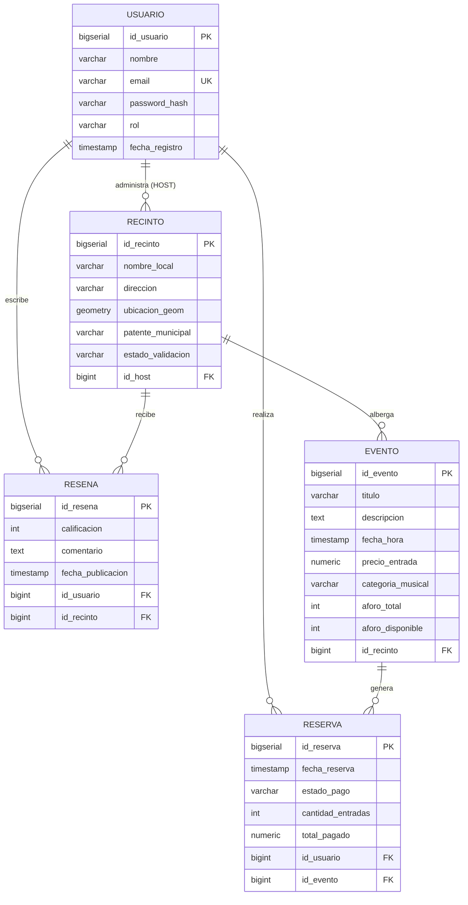
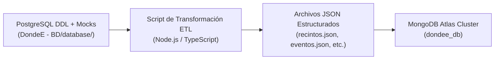
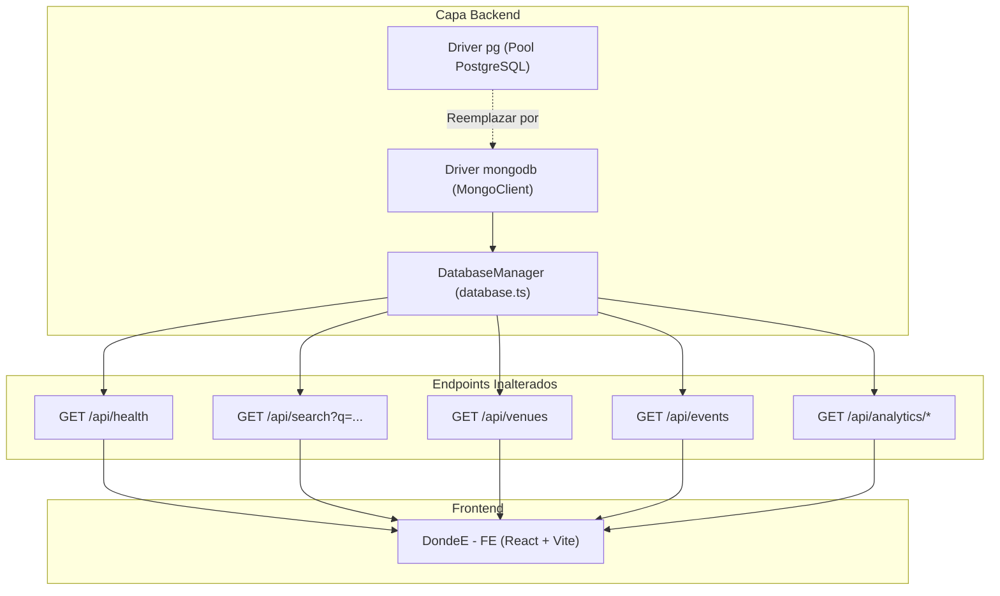

# Plan Maestro y Análisis Arquitectural: Migración de PostgreSQL/PostGIS a MongoDB NoSQL (Entrega 2)

**Proyecto:** DondeE — Plataforma Geo-Social de Vida Nocturna  
**Asignatura:** ICI 324 - Bases de Datos y Programación Web (2026)  
**Institución:** Universidad de Valparaíso / Escuela de Ingeniería Informática  
**Grupo de Desarrollo:** Grupo 2 (Martín Araya, Jorge Bahamondes, Bruno Díaz)  
**Rol Profesional:** Senior NoSQL Database Architect & Full-Stack Systems Engineer  
**Fecha:** Octubre 2026  

---

## 1. Resumen Ejecutivo y Alcance

Este documento constituye el **análisis técnico y formal de arquitectura** para ejecutar la transición de la base de datos relacional (`DondeE - BD/database/init.sql`) utilizada en la Entrega 1 hacia un motor NoSQL orientado a documentos (**MongoDB Atlas Cluster**), cumpliendo los estándares de la **Entrega 2**.

### Objetivos Clave:
1. **Rediseñar el modelo relacional a un modelo documental**, aprovechando las capacidades nativas de MongoDB (embebido de subdocumentos, desnormalización estratégica y GeoJSON).
2. **Definir el pipeline de conversión a formato `.json`**, preservando la integridad de los 42 locales validados, los 126 eventos nocturnos de Valparaíso y Viña del Mar, los usuarios y el histórico transaccional.
3. **Establecer la estrategia de geolocalización NoSQL**, reemplazando funciones PostGIS (`ST_SetSRID`, `ST_MakePoint`, `ST_DWithin`) por índices espaciales `2dsphere` y operadores geoespaciales (`$near`, `$geoNear`, `$geoWithin`).
4. **Garantizar la compatibilidad total con el Frontend**, manteniendo inalterados los contratos REST (`/api/search`, `/api/venues`, `/api/events`, etc.) para que la aplicación web funcione de manera transparente y sin fricción.

---

## 2. Diagnóstico del Estado Actual (Modelo Relacional - Entrega 1)

El sistema de la Entrega 1 se compone de **5 tablas normalizadas** bajo el estándar SQL ANSI con tipos geométricos espaciales:



### Fortalezas y Limitaciones del Modelo Actual:
* **Fortaleza SQL:** Integridad referencial estricta vía `FOREIGN KEY` y chequeos a nivel de motor (`CHECK aforo_disponible <= aforo_total`).
* **Fricción en DondeE:** La aplicación web es de **lectura masiva en tiempo real** (usuarios explorando locales en el mapa, filtrando por barrios y consultando eventos). Cada consulta de la interfaz requiere ejecutar múltiples `JOIN` entre `recinto`, `evento`, `resena` y `usuario`, agregando costo computacional innecesario en bases de datos relacionales tradicionales.

---

## 3. Criterios de Modelado NoSQL: Embeber vs. Referenciar

El error más común al migrar de SQL a NoSQL es realizar una copia 1:1 de tablas a colecciones (anti-patrón relacional en MongoDB). En MongoDB debemos diseñar considerando **cómo la aplicación consulta los datos (Access Patterns)**.

### Matriz de Decisión Arquitectural

| Entidad / Relación | Decisión NoSQL | Justificación Técnica |
| :--- | :--- | :--- |
| **Recinto -> Reseñas (1:N)** | **EMBEBER** (Array de subdocumentos) | Las reseñas de un local casi nunca se leen aisladas; se despliegan junto con la ficha del recinto en la ventana inferior (*Bottom Sheet*). Embeberlas permite obtener el recinto, sus reseñas y calcular su rating promedio en **1 sola lectura de disco (Single Document Read)**. |
| **Recinto -> Host (N:1)** | **EMBEBER INFORMACIÓN BÁSICA** (*Extended Reference*) | Guardamos un snapshot del host `{ id_host, nombre, email }` dentro del documento del recinto. No se necesita hacer `JOIN` con la tabla de usuarios para mostrar el responsable del recinto. |
| **Recinto -> Eventos (1:N)** | **COLECCIÓN INDEPENDIENTE + DESNORMALIZACIÓN** | Aunque un evento pertenece a un recinto, los eventos tienen su propio ciclo de vida: la cartelera busca eventos por fecha, artista y género musical independientemente del mapa. Embeber cientos de eventos en el recinto provocaría que el documento del recinto exceda los límites recomendados (máx. 16 MB en BSON) y dificultaría la indexación de eventos. |
| **Evento -> Recinto (N:1)** | **DESNORMALIZAR DATOS CLAVE DEL RECINTO** | En cada evento guardamos el `id_recinto`, `nombre_local`, `direccion`, `ciudad` y sus coordenadas `ubicacion`. Así, cuando el buscador devuelve un evento, la interfaz ya tiene las coordenadas para posicionar la cámara del mapa (`flyTo`) sin consultar la colección de recintos. |
| **Usuario -> Reservas (1:N)** | **COLECCIÓN SEPARADA CON REFERENCIA Y SNAPSHOT** | Las reservas son transacciones financieras. Se guardan en una colección `reservas` independiente con referencias a `id_usuario` y `id_evento`, pero guardando un *snapshot inmutable* del evento (título, precio pagado y fecha al momento de la compra). |

---

## 4. Formato y Esquema de las Colecciones JSON / BSON

A continuación se detalla la conversión exacta de tipos de datos relacionales a tipos BSON/JSON de MongoDB:

* **Identificadores:** `BIGSERIAL` / `BIGINT` -> Se mantiene el campo numérico (`id_recinto`, `id_evento`, etc.) para **retrocompatibilidad 100% con el Frontend**, acompañado del identificador nativo `_id: ObjectId(...)`.
* **Geometría Espacial:** `GEOMETRY(POINT, 4326)` -> Objeto **GeoJSON Point**:
  ```json
  "ubicacion": {
    "type": "Point",
    "coordinates": [-71.6245, -33.0425]
  }
  ```
  *(Orden estándar: [Longitud, Latitud] en WGS84)*
* **Fechas:** `TIMESTAMP` -> Cadenas en formato **ISO 8601** (`YYYY-MM-DDTHH:mm:ss.sssZ`) que MongoDB interpreta y almacena internamente como `BSON UTC Date`.
* **Moneda / Montos:** `NUMERIC(10,2)` -> Números flotantes de doble precisión (`Double`) o `Decimal128` en MongoDB.

---

### 4.1. Colección: `recintos`
Contendrá los **42 locales validados** (21 en Valparaíso y 21 en Viña del Mar).

```json
{
  "_id": { "$oid": "67069b12a01b4c0001000001" },
  "id_recinto": 1,
  "nombre_local": "Club El Huevo",
  "direccion": "Blanco 1386, Valparaíso",
  "sector": "Barrio Puerto / Blanco",
  "ciudad": "Valparaíso",
  "tipo": "club",
  "patente_municipal": "PAT-VALP-001",
  "estado_validacion": "APROBADO",
  "aforo_total": 500,
  "aforo_disponible": 42,
  "precio_entrada": 10000,
  "rating": 4.8,
  "reviews_count": 420,
  "ubicacion": {
    "type": "Point",
    "coordinates": [-71.6245, -33.0425]
  },
  "host": {
    "id_usuario": 9,
    "nombre": "Host Valparaíso Puerto SpA",
    "email": "contacto@valpopuerto.cl"
  },
  "resenas": [
    {
      "id_resena": 1,
      "calificacion": 5,
      "comentario": "Los 3 ambientes de El Huevo estuvieron increíbles. La pista subterránea de techno estuvo a otro nivel.",
      "fecha": "2026-10-07T12:00:00.000Z",
      "usuario": {
        "id_usuario": 2,
        "nombre": "Diego Silva",
        "email": "diego.silva@alumnos.usm.cl"
      }
    }
  ]
}
```

---

### 4.2. Colección: `eventos`
Contendrá los **126 eventos nocturnos** generados en la base de datos (3 por cada uno de los 42 locales).

```json
{
  "_id": { "$oid": "67069b12a01b4c0002000001" },
  "id_evento": 1,
  "titulo": "Noche Estelar en Club El Huevo",
  "descripcion": "Evento principal de fin de semana con producción especial de Club El Huevo",
  "fecha_hora": "2026-10-10T22:30:00.000Z",
  "precio_entrada": 8000.00,
  "categoria_musical": "Hits & Bailable",
  "aforo_total": 250,
  "aforo_disponible": 35,
  "id_recinto": 1,
  "nombre_local": "Club El Huevo",
  "direccion": "Blanco 1386, Valparaíso",
  "ciudad": "Valparaíso",
  "ubicacion": {
    "type": "Point",
    "coordinates": [-71.6245, -33.0425]
  },
  "banner_image": "https://images.unsplash.com/photo-1516450360452-9312f5e86fc7?auto=format&fit=crop&w=1200&q=80",
  "productora": "Producción Central Club El Huevo",
  "ticket_provider": "Passline Oficial",
  "hot": true,
  "artistas": ["DJ Residente El Huevo", "VJ Live Set"]
}
```

---

### 4.3. Colección: `usuarios`
Contendrá los asistentes registrados, administradores y hosts comerciales.

```json
{
  "_id": { "$oid": "67069b12a01b4c0003000001" },
  "id_usuario": 1,
  "nombre": "Valentina Morales",
  "email": "valen.morales@gmail.com",
  "password_hash": "$2b$12$e8Y6bF0ZzLkW6v3nK0gM5.U3X8P2v8J9fK2A7B6C5D4E3F2G1H0I",
  "rol": "CLIENTE",
  "fecha_registro": "2026-09-20T14:30:00.000Z"
}
```

---

### 4.4. Colección: `reservas`
Contendrá las transacciones de compra de tickets con snapshot histórico.

```json
{
  "_id": { "$oid": "67069b12a01b4c0004000001" },
  "id_reserva": 1,
  "fecha_reserva": "2026-10-09T13:00:00.000Z",
  "estado_pago": "PAGADO",
  "cantidad_entradas": 2,
  "total_pagado": 20000.00,
  "usuario": {
    "id_usuario": 1,
    "nombre": "Valentina Morales",
    "email": "valen.morales@gmail.com"
  },
  "evento": {
    "id_evento": 1,
    "titulo": "Noche Estelar en Club El Huevo",
    "fecha_hora": "2026-10-10T22:30:00.000Z",
    "nombre_local": "Club El Huevo"
  }
}
```

---

---

### 4.5. Colección: `resenas`
Para garantizar exhaustividad académica y responder tanto a la opción de **embebido** en recintos como a la opción de **colección independiente** para auditoría y reportería analítica global, se exporta la colección `resenas`:

```json
{
  "_id": { "$oid": "67069b120000000500000001" },
  "id_resena": 1,
  "id_recinto": 1,
  "nombre_local": "Club El Huevo",
  "calificacion": 5,
  "comentario": "Los 3 pisos de El Huevo nunca defraudan. El sótano de techno subterráneo es insuperable en la Quinta Región.",
  "fecha": "2026-10-07T12:00:00.000Z",
  "usuario": {
    "id_usuario": 2,
    "nombre": "Diego Silva",
    "email": "diego.silva@alumnos.usm.cl"
  }
}
```

---

### 4.6. Tabla de Cuadratura y Verificación de Conteos e Integridad Cuantitativa

A diferencia de un diseño meramente ilustrativo, **los datos han sido migrados e integrados en archivos físicos reales `.json`** ubicados en el repositorio en `DondeE - BD/datasets_json/` y `Documentos/datasets_json/`. 

La siguiente tabla certifica la correspondencia unívoca entre el origen relacional PostgreSQL y los documentos generados para MongoDB:

| Entidad / Tabla Origen (PostgreSQL) | Colección Destino (MongoDB) | Archivo JSON Físico Exportado | Total Registros SQL | Total Documentos NoSQL | Rango de Identificadores | Estado de Integridad |
| :--- | :--- | :--- | :---: | :---: | :---: | :---: |
| **`recinto`** | `recintos` | `datasets_json/recintos.json` | **42** | **42** | `id_recinto: 1 .. 42` | ✓ 100% Coincidente (21 Valpo, 21 Viña con GeoJSON) |
| **`evento`** | `eventos` | `datasets_json/eventos.json` | **126** | **126** | `id_evento: 1 .. 126` | ✓ 100% Coincidente (3 eventos por cada local) |
| **`usuario`** | `usuarios` | `datasets_json/usuarios.json` | **13** | **13** | `id_usuario: 1 .. 13` | ✓ 100% Coincidente (8 clientes, 4 hosts, 1 admin) |
| **`reserva`** | `reservas` | `datasets_json/reservas.json` | **8** | **8** | `id_reserva: 1 .. 8` | ✓ 100% Coincidente (Snapshots inmutables) |
| **`resena`** | `resenas` (y en `recintos`) | `datasets_json/resenas.json` | **44** | **44** | `id_resena: 1 .. 44` | ✓ 100% Coincidente (Ratings 1..5 y usuarios reales) |

> [!IMPORTANT]
> **Trazabilidad Garantizada:** Cada documento conserva su identificador numérico relacional (`id_recinto`, `id_evento`, `id_usuario`, `id_reserva`, `id_resena`) junto con el identificador canónico nativo `_id: { "$oid": "..." }`, permitiendo validar que ningún dato ni relación se perdió durante la transición.

---

## 5. Procedimiento de Traspaso y Generación de Datasets JSON

Para poblar MongoDB Atlas sin perder datos ni consistencia, se define un **Pipeline de Extracción, Transformación y Carga (ETL)**:



### Reglas de Transformación del Pipeline ETL:
1. **Conversión PostGIS -> GeoJSON:**
   * La sentencia SQL `ST_SetSRID(ST_MakePoint(-71.6245, -33.0425), 4326)` se transforma a:
     `{ "type": "Point", "coordinates": [-71.6245, -33.0425] }`.
2. **Cálculo de Agregaciones en Tiempo de Carga:**
   * A partir de las reseñas registradas en SQL para cada local, se calculan y guardan los valores iniciales `rating` y `reviews_count` directamente en el documento del recinto.
3. **Validación de Integridad:**
   * Verificar que todas las coordenadas de longitud estén entre `-71.70` y `-71.40` y latitudes entre `-33.10` y `-32.90` (cuenca urbana de Valparaíso y Viña del Mar).
   * Validar que ningún evento tenga `aforo_disponible > aforo_total`.

---

## 6. Implementación en MongoDB Atlas

### 6.1. Configuración de Seguridad y Red (Network Access)
El usuario proporcionó las credenciales del clúster:
* **Usuario:** `brunodiazfer1998_db_user`
* **Contraseña:** `R13BtQy6J4KaW3Np`
* **IP actual:** `200.14.70.4`

> [!WARNING]
> **Riesgo Operativo de IP Dinámica:**  
> La IP `200.14.70.4` corresponde a una conexión residencial chilena dinámica. Si la IP del router se renueva o si los compañeros de equipo intentan conectarse desde sus hogares, la conexión será rechazada con error `MongoServerSelectionError: connection timed out`.  
> **Recomendación para la Entrega:** En la consola de MongoDB Atlas -> **Network Access**, agregar la regla temporal `0.0.0.0/0` (*Allow access from anywhere*) para garantizar que la aplicación funcione en cualquier equipo o entorno de evaluación del profesor.

---

### 6.2. Cadena de Conexión y Variable de Entorno
En el archivo `DondeE - BE/.env` del backend se configurará:
```env
PORT=3001
MONGODB_URI=mongodb+srv://brunodiazfer1998_db_user:R13BtQy6J4KaW3Np@<nombre-cluster>.mongodb.net/dondee_db?retryWrites=true&w=majority
MONGODB_DBNAME=dondee_db
```

---

### 6.3. Índices Indispensables en MongoDB
Para que el motor NoSQL supere en rendimiento a PostgreSQL, se deben crear los siguientes índices obligatorios:

```javascript
// 1. Índice Geoespacial 2dsphere para búsqueda por radio y cercanía GPS
db.recintos.createIndex({ "ubicacion": "2dsphere" });
db.eventos.createIndex({ "ubicacion": "2dsphere" });

// 2. Índice único para evitar duplicación de cuentas de usuario
db.usuarios.createIndex({ "email": 1 }, { unique: true });

// 3. Índice para acelerar la búsqueda por ID numérico (compatibilidad frontend)
db.recintos.createIndex({ "id_recinto": 1 }, { unique: true });
db.eventos.createIndex({ "id_evento": 1 }, { unique: true });

// 4. Índices de texto compuesto para la barra de búsqueda en tiempo real
db.recintos.createIndex({ "nombre_local": "text", "direccion": "text", "sector": "text", "ciudad": "text" });
db.eventos.createIndex({ "titulo": "text", "descripcion": "text", "categoria_musical": "text" });

// 5. Índices de filtrado frecuente
db.eventos.createIndex({ "precio_entrada": 1, "aforo_disponible": 1 });
db.eventos.createIndex({ "fecha_hora": 1 });
```

---

## 7. Traducción de la Rúbrica: SQL vs. MongoDB (MQL & Aggregation)

A continuación se presenta la tabla de equivalencias de las consultas académicas obligatorias, demostrando cómo se traducen desde SQL a MongoDB:

### Consulta 1: Filtro Simple y Proyección
* **SQL:**
  ```sql
  SELECT titulo, fecha_hora, precio_entrada
  FROM evento
  WHERE precio_entrada > 10000 AND aforo_disponible > 0;
  ```
* **MongoDB (MQL):**
  ```javascript
  db.eventos.find(
    { precio_entrada: { $gt: 10000 }, aforo_disponible: { $gt: 0 } },
    { projection: { _id: 0, titulo: 1, fecha_hora: 1, precio_entrada: 1 } }
  );
  ```

---

### Consulta 2: Búsqueda Geoespacial por Radio de Cercanía (3 km desde Plaza Aníbal Pinto)
* **SQL (PostGIS):**
  ```sql
  SELECT nombre_local, direccion
  FROM recinto
  WHERE ST_DWithin(ubicacion_geom, ST_SetSRID(ST_MakePoint(-71.6248, -33.0445), 4326)::geography, 3000);
  ```
* **MongoDB (GeoJSON + `$near`):**
  ```javascript
  db.recintos.find({
    ubicacion: {
      $near: {
        $geometry: { type: "Point", coordinates: [-71.6248, -33.0445] },
        $maxDistance: 3000
      }
    }
  }, { nombre_local: 1, direccion: 1 });
  ```

---

### Consulta 3: Agrupación y Métricas por Recinto (`GROUP BY` + `AVG`/`SUM`/`COUNT`)
* **SQL:**
  ```sql
  SELECT r.id_recinto, r.nombre_local, COUNT(e.id_evento) AS total_eventos,
         COALESCE(SUM(e.aforo_total), 0) AS capacidad_total,
         ROUND(COALESCE(AVG(e.precio_entrada), 0), 2) AS precio_promedio
  FROM recinto r
  LEFT JOIN evento e ON r.id_recinto = e.id_recinto
  GROUP BY r.id_recinto, r.nombre_local;
  ```
* **MongoDB (Aggregation Pipeline):**
  ```javascript
  db.eventos.aggregate([
    {
      $group: {
        _id: "$id_recinto",
        nombre_local: { $first: "$nombre_local" },
        total_eventos: { $sum: 1 },
        capacidad_total: { $sum: "$aforo_total" },
        precio_promedio: { $avg: "$precio_entrada" }
      }
    },
    { $sort: { total_eventos: -1 } }
  ]);
  ```

---

### Consulta 4: Ranking con Filtro Post-Agregación (`HAVING`)
* **SQL:**
  ```sql
  SELECT r.nombre_local, COUNT(res.id_resena) AS cantidad_resenas, ROUND(AVG(res.calificacion), 1) AS promedio_real
  FROM recinto r
  INNER JOIN resena res ON r.id_recinto = res.id_recinto
  GROUP BY r.id_recinto, r.nombre_local
  HAVING COUNT(res.id_resena) >= 1
  ORDER BY promedio_real DESC
  LIMIT 5;
  ```
* **MongoDB (Embebido o Aggregation):**
  Al estar embebidas las reseñas en `recintos`:
  ```javascript
  db.recintos.aggregate([
    { $match: { "resenas.0": { $exists: true } } },
    {
      $project: {
        nombre_local: 1,
        cantidad_resenas: { $size: "$resenas" },
        promedio_real: { $avg: "$resenas.calificacion" }
      }
    },
    { $sort: { promedio_real: -1, cantidad_resenas: -1 } },
    { $limit: 5 }
  ]);
  ```

---

### Consulta 5: Alerta de Aforo Crítico (Operación Matemática en el Filtro)
* **SQL:**
  ```sql
  SELECT id_evento, titulo, nombre_local, aforo_disponible, aforo_total
  FROM evento e
  WHERE aforo_disponible > 0 AND (aforo_disponible::numeric / aforo_total::numeric) <= 0.20;
  ```
* **MongoDB (Expresión Aritmética `$expr`):**
  ```javascript
  db.eventos.find({
    aforo_disponible: { $gt: 0 },
    $expr: {
      $lte: [ { $divide: ["$aforo_disponible", "$aforo_total"] }, 0.20 ]
    }
  });
  ```

---

### Consulta 6: Usuarios Inactivos (Diferencia de Conjuntos / `EXCEPT`)
* **SQL:**
  ```sql
  SELECT id_usuario, nombre, email FROM usuario
  EXCEPT
  SELECT u.id_usuario, u.nombre, u.email FROM usuario u
  INNER JOIN reserva res ON u.id_usuario = res.id_usuario WHERE res.estado_pago = 'PAGADO';
  ```
* **MongoDB (`$lookup` + `$match` sobre arreglo vacío):**
  ```javascript
  db.usuarios.aggregate([
    {
      $lookup: {
        from: "reservas",
        localField: "id_usuario",
        foreignField: "usuario.id_usuario",
        as: "compras"
      }
    },
    { $match: { "compras": { $size: 0 } } },
    { $project: { id_usuario: 1, nombre: 1, email: 1 } }
  ]);
  ```

---

## 8. Plan de Migración en el Backend (`DondeE - BE`)

Para adaptar la API Express / TypeScript sin romper el frontend:



### Pasos Técnicos para el Backend:
1. **Instalación de Dependencias:**
   ```bash
   cd "DondeE - BE"
   npm install mongodb
   npm install -D @types/mongodb
   ```
2. **Refactorización de `DondeE - BE/src/database.ts`:**
   * Crear instancia singleton de `MongoClient` usando la URI de MongoDB Atlas.
   * Modificar el método `search(q)` para utilizar consultas de texto o expresiones regulares optimizadas sobre las colecciones `recintos` y `eventos`.
   * Modificar `getHealth()` para reportar el estado de la conexión a MongoDB Atlas y las versiones de motor y colecciones.
   * Mantener el mecanismo de **failover seguro en memoria** en caso de pérdida transitoria de conexión a internet.
3. **Persistencia Transaccional:**
   * Actualizar los métodos `POST /api/reviews` y `POST /api/reservations` para realizar escrituras atómicas en las colecciones de MongoDB (`updateOne` con `$push` para reseñas y `insertOne` para reservas).

---

## 9. Hoja de Ruta de Ejecución Recomendada

```
[Fase 1] Generación de los archivos JSON de datos (recintos.json, eventos.json, usuarios.json, reservas.json).
   |
   v
[Fase 2] Creación del script de Seed / Carga automática en MongoDB Atlas con configuración de índices.
   |
   v
[Fase 3] Configuración de variables de entorno (.env) con la cadena de conexión de Atlas.
   |
   v
[Fase 4] Implementación del adaptador MongoDB en DatabaseManager (database.ts).
   |
   v
[Fase 5] Pruebas de integración: verificación de la búsqueda interactiva, mapa, reserva de tickets y endpoints analíticos.
   |
   v
[Fase 6] Actualización del informe y documentación para la entrega final.
```

---

*Documento técnico preparado para el proyecto académico DondeE — Segundo Semestre 2026.*
